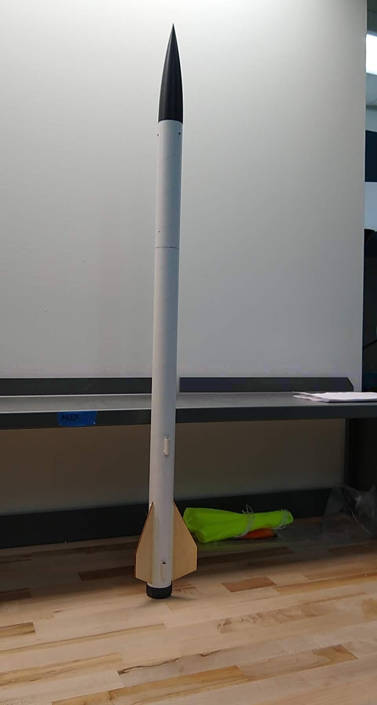
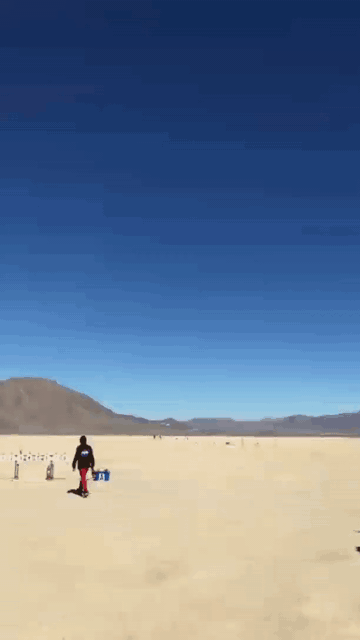

# Level 1 Certification Rocket

<table>
  <tr>
    <td align="center"></td>
    <td align="center"></td>
  </tr>
  <tr>
    <td align="center">The finished rocket before launch</td>
    <td align="center">Certification flight</td>
  </tr>
</table>

A high-power rocket I built and flew for my **Level 1 high-power certification** with the [National Association of Rocketry (NAR)](https://www.nar.org/high-power-rocketry-info/level-1-high-power-certification/).

- **Reached over 3,000 feet**
- **Earned my NAR Level 1 certificate**, which certifies me to fly H and I impulse motors

## The build

Built from a [LOC Precision Weasel](https://locprecision.com/products/weasel) kit for Harvey Mudd College's [Advanced Rocketry](https://pages.hmc.edu/spjut/AdvRoc/RocketryCertification.md.html) class:

- 1.63" cardboard airframe with a separating payload section and a black nose cone
- Laser-cut plywood fins, epoxied and filleted
- 29 mm motor mount with a screw-on motor retainer
- Rail guides for launching off a rail
- Parachute recovery (the lime-green chute in the photo), with a Kevlar shock cord

Level 1 requires you to build the rocket yourself, fly it on an H or I motor, and recover it in a condition that could fly again, with a certified observer watching.

## Media

`tools/` has the scripts used to prepare the media:

- `remove_caption.py` removes the Snapchat caption bar from the original photo.
- `make_gif.sh` turns the launch video into a silent GIF.
